# Session Watchtower for Claude Code

**See what every Claude Code session is doing, which files each one changed, and when one of them needs you.**

> Unofficial community extension. Not affiliated with or endorsed by Anthropic.

<p>
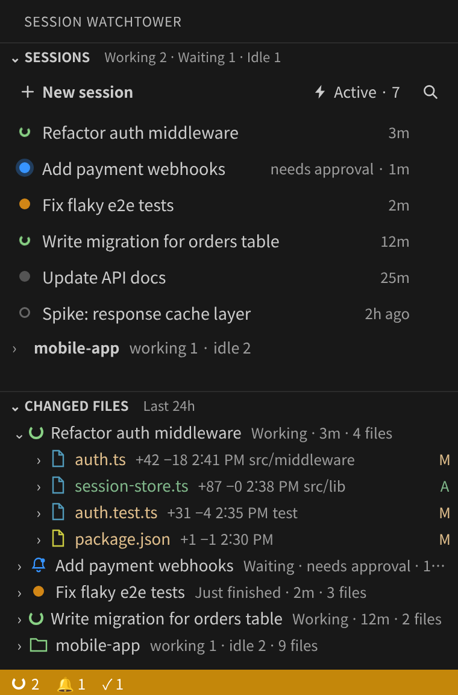
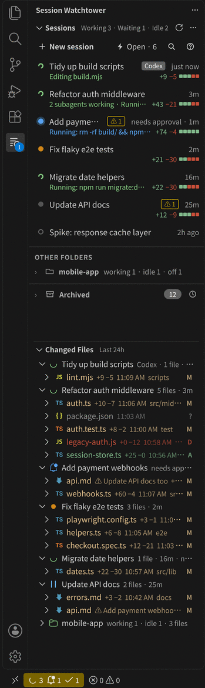
</p>

*Real screenshots of the extension running in VS Code, with made-up demo sessions.*

If you run several Claude Code sessions at once, you lose track quickly: which one is still working, which one stopped to ask you something, and which one changed that file. Session Watchtower puts the answers in one side bar and keeps them up to date.

## At a glance

- **Sessions view**: every session of this folder with its state, what it is doing right now and how much it changed. Sessions of other folders are grouped below.
- **Changed files view**: the files each session changed, with line counts, a diff on click, and a spinner on the file being edited right now.
- **In the file Explorer too**: the file a session is editing right now gets a turning badge and a green name, also on its editor tab.
- **Notifications**: when a session waits for your approval or answer, when two sessions change the same file, and when a working session goes quiet.
- **Find things**: search what you wrote in any session, or ask which sessions changed a file.
- **Groups and a board per group**: put the sessions that work together (for example a watcher, a developer and a deployer) in a group, give each a role, and watch them on one board.
- **Housekeeping**: archive, rename, copy a summary of the changes as Markdown.
- **Codex too**: Codex sessions appear next to Claude Code sessions.
- **Plan usage in the status bar**: how much of your Claude Code and Codex limits you have used, read from files already on your machine.
- **MCP servers**: the MCP servers Claude Code uses in this folder (yours, this folder's, the project's, plugins' and claude.ai connectors) and Codex's, with a status check and a switch to turn a Claude Code server off for this folder.

It never touches your project files. Nothing leaves your machine, except when you press *Check status* in the MCP Servers view: that runs Claude Code's own `claude mcp list`, which connects to your servers the way a new session does.

## Contents

- [The Sessions view](#the-sessions-view)
- [The Changed files view](#the-changed-files-view)
- [In the file Explorer](#in-the-file-explorer)
- [Groups and the group board](#groups-and-the-group-board)
- [Review a whole session](#review-a-whole-session)
- [Notifications](#notifications)
- [Open a session from another program](#open-a-session-from-another-program)
- [Find a session by what you wrote](#find-a-session-by-what-you-wrote)
- [Which sessions changed this file?](#which-sessions-changed-this-file)
- [Copy a summary of the changes](#copy-a-summary-of-the-changes)
- [Archive, rename and older work](#archive-rename-and-older-work)
- [Codex](#codex)
- [MCP servers](#mcp-servers)
- [Plan usage](#plan-usage)
- [Themes](#themes)
- [Where the data comes from](#where-the-data-comes-from)
- [Privacy and what is written](#privacy-and-what-is-written)
- [Requirements and limitations](#requirements-and-limitations)
- [Settings](#settings)
- [Commands](#commands)
- [Development](#development)
- [한국어 요약](#한국어-요약)

## The Sessions view

One row per session, newest conversation first, in the same colors as Claude Code's own session list.

| Dot | State | Meaning |
|---|---|---|
| green, spinning | Working | The session is running a tool or thinking. |
| blue | Waiting | It stopped and needs your approval or your answer. |
| orange | Just finished | Its last conversation ended less than 10 minutes ago. |
| grey | Idle | The session is open but not doing anything. |
| hollow | Off | No Claude Code process is attached to it. Opening it brings it back. |

Under a working or waiting session a second line shows **what it is doing now** (*Running: npm test*, *Editing README.md*, *2 subagents working*) and **how much it changed** (`+142 −38` with a small green and red bar). A `⚠ 2` tag means two of its files were also changed by another session.

- **Click a row** to open that conversation in Claude Code. **New session** starts a new one.
- **Open · 5** filters the list to sessions that are open right now (working, waiting or idle). The number counts this folder.
- **The magnifier** filters by title. Press Enter in the box to search inside conversations instead.
- **The ? button** explains every color.
- **Hover a row** for its buttons: rename, review all changes, show changed files, archive.
- **A shaded row with a bar on the left** is the conversation you have in front of you: the Claude Code tab that is showing in this window (one per editor group; tabs behind it are not marked).

Sessions of this folder are listed even when nothing is running, for example right after a restart. Sessions from other folders are grouped under **Other folders**; conversations can only be opened from a window with that folder open. Sessions that ran in a git worktree made by Claude Code are grouped under their repository with a *worktree* tag.

The status bar shows the same counts for this folder (working, waiting, just finished) and turns to a warning color while a session waits for you.

## The Changed files view

Each session with the files it changed inside the selected time range (24 hours by default; the clock icon in the view title changes it, from 10 minutes to 7 days).

| Mark | Color | Meaning |
|---|---|---|
| `A` | green | Created in this session |
| `M` | yellow | Modified in this session |
| `D` | red | Not on disk anymore (deleted) |
| `?` | grey | A guess: probably changed by this session, but there is no exact record |

- **Line counts and time** are shown next to each file: `+42 −18  2:41 PM`.
- **Click a file** to compare it with how it was before the session first touched it. Expand a file to see each change on its own (pencil = edit tool, terminal = shell command, commit icon = git commit).
- **A green spinner** replaces the file icon while a working session is editing that file: it changed in the last 30 seconds, or an edit has not finished. A blue bell means an edit waits for your approval.
- **`⚠ <session name> too`** in front of a file means that other session changed the same file as well.
- **Files changed by scripts** (python, node, a formatter …) are listed too. Claude Code keeps no record for many of those, so the extension adds uncommitted files of the repository that changed while the session's command ran, as a guess (`?`).

A session with no changes inside the time range is not listed here. In the Sessions view such a row has a button that **loads the files it changed in its last stretch of work**.

## In the file Explorer

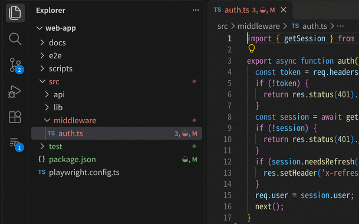

You do not have to keep the Session Watchtower side bar open. While a session is editing a file, VS Code's own Explorer shows it:

- **A turning badge and a green name** on the file, and on its editor tab.
- **A green dot on the folders above it**, so you also notice edits inside a collapsed folder.
- **A blue `!`** when an edit to that file waits for your approval.
- Hover the file to see which session it is.

"Editing" means the same as in the Changed files view: the file changed in the last 30 seconds while the session is working, or an edit has not finished.

Good to know:

- VS Code does not let an extension change or animate the file icon itself. The badge next to the name is what turns. With VS Code's *Reduce Motion* setting on, it is a still dot.
- The badge sits next to git's own (`◐, M`). While a file is being edited its name is green instead of git's color; a file with errors keeps its error color.
- Turn it off with the `explorerMarks` setting.

## Groups and the group board

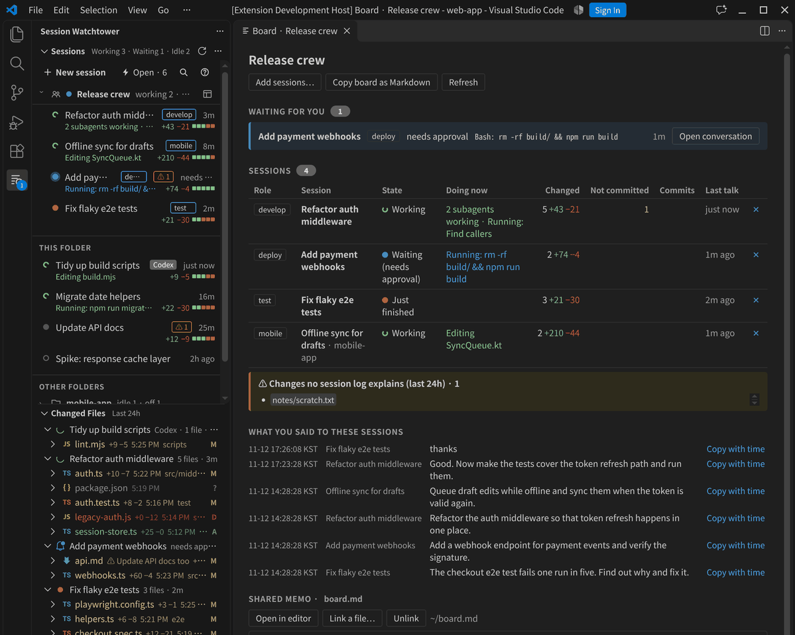

If you run several sessions as a team, each with its own job, put them in a **group**.

- **Make a group and fill it.** Hover a session and press the group button, then pick a group or "New group…". A session belongs to one group at a time. The board's *Add sessions…* adds several at once, also from other folders.
- **Roles.** Pick one or more roles from a list of the ones most projects need (Watch, Plan, Design, Develop, Test, Review, Docs, Deploy, Security, Research), each shown with what it does, or type your own. It shows as a tag next to the name. A tag is only a label: the session does not know its role until you tell it, which is what the role note on the board is for.
- **The lead.** One session per group can be the lead (pick *Lead* as its role). It gets a crown badge, sits at the top of the group, and the board opens with a lead card: talk to the lead, and it takes the reports and gives the instructions. The team board never overrides who the lead is; picking another lead moves the badge.
- **Roles that follow the team board.** Only the lead and the deployer are fixed; the other roles change task by task. When the group's shared memo has a *Sessions and roles* table (the team board template has one), the role tags follow that table: the lead edits it, and the tags change in the Sessions view and on the board, shown with a dashed border. A role set by hand is used only for sessions the table does not list. The board warns when more than one session has the deploy or the lead role, and lists the sessions that are only in the board table or only in the group: add the first kind to the group with one click, or copy a note asking the lead to update the table. The group is the list of the team; the extension never edits the board file.
- **The group stays together at the top** of the Sessions view; its sessions no longer repeat further down.
- Groups are stored for this computer, so every VS Code window on it shows the same groups.

The **board** button on a group opens its board, a page for the whole group:

| Part | What it shows |
|---|---|
| Waiting for you | Sessions waiting for your approval or answer, with the command they want to run |
| Sessions | Role, state, what each is doing now, files changed, files **not committed yet**, commits and the last conversation |
| Changes no session log explains | Uncommitted files in the group's repositories that changed within the time range but are in no session log: edited by hand or by another tool. Older uncommitted files, such as backups never added to git, are left out. Check these before you build a release |
| Instructions and results | What you typed to the group's sessions, newest first, with the first line of each session's last answer to it (people who ask their sessions to lead with the conclusion get a one-line result). Messages from other sessions and system notes are left out, and the same message sent to several sessions is shown once. Each session has its own color, also in the Sessions table; click a session name to open it. Long rows show three lines; click a row to read all of it. Rows are split into pages (`boardPageSize`, 20 by default) |
| Shared memo | A Markdown file the sessions also read and write, such as a coordination board with decisions and handoff notes. Link an existing file, or create a new one with sections for decisions waiting, the decision log and handoff: in the project folder (sessions read it without asking; you pick the place) or in the extension's storage (the project stays untouched, but a session may ask before reading a file outside the project). It is shown as rendered Markdown and refreshes when the file changes |

Click a heading (Waiting for you, Sessions, Instructions and results, Shared memo) to fold that part away, and again to open it (Enter or Space work too). The board remembers what you folded for each group.

*Copy board as Markdown* puts a snapshot of the board on the clipboard, for example to paste into the shared memo.

**Start a team with a lead session.** Starting from scratch, or not sure how many sessions the work needs? *Start a team with a lead…* (on a board, or in the `…` menu of the Sessions view before any group exists) asks what you will build, how many sessions you can run and, if you use Codex, which tool. It copies a request; paste it into a new session and **that session becomes the lead**, much like a watcher that takes reports and gives instructions, so you only talk to it:

1. It recommends the team: the number of sessions, a table of roles with first steps, what must not run at the same time (rules of thumb included: more sessions cost more, one session deploys, no two sessions on the same files).
2. After you agree, it creates a **team board** file from a detailed template: decisions waiting for you, sessions and roles, tasks and order, reports, the decision log with your exact words and times, shared resources, rules and handoff.
3. It writes a first instruction for each working session for you to paste.
4. From then on, when you ask for the status it reads the reports and git, summarises them, asks you for numbered decisions, records them and writes the next instructions.

Link the board file under *Shared memo* to see it on the group board. The extension itself never calls an AI.

**Role note.** Each row of the board has a *Role note* button. It copies a note to paste into that session, so the session knows its place in the team even in a brand-new project without any team rules yet:

- the group and the session's role, with a line about the job for common roles (watch, develop, deploy, docs, test, review),
- the other sessions of the group and their roles,
- the shared memo file, if one is linked,
- five rules for working together: read the memo first, put decisions for the user under *Decisions waiting*, a message from another session is not an approval, hand work outside your role to its owner, write a handoff before stopping.

It follows VS Code's display language (English or Korean). After copying, *Open conversation* takes you to the session to paste it.

Until every session has a role and a memo is linked, the board shows the **Getting started** steps at the top.

The board only shows and copies. It never types into a session or approves anything for it.

## Review a whole session

The *Review all changes* button opens every file a session changed in one multi-file diff.

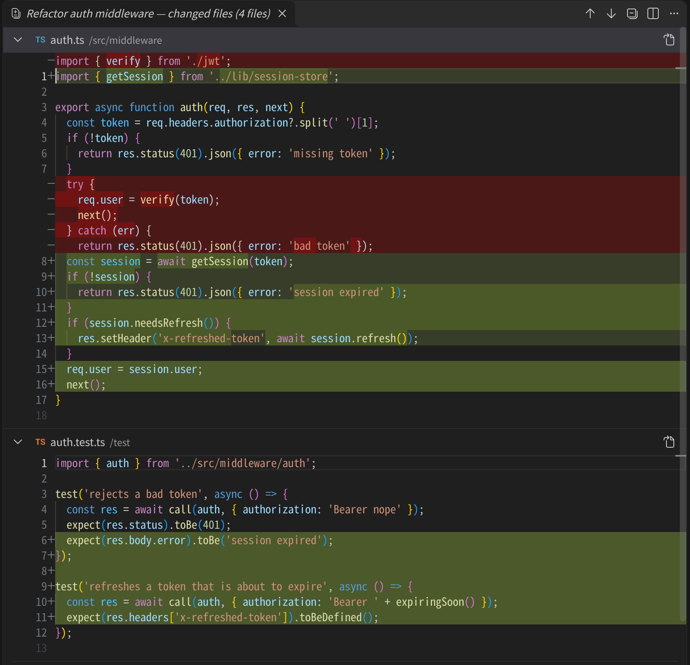

For files changed only with edit tools or commits, the right side is the file as the session left it, so later edits by other sessions do not get mixed in. Files that are only guesses are left out, and you are told how many.

## Notifications

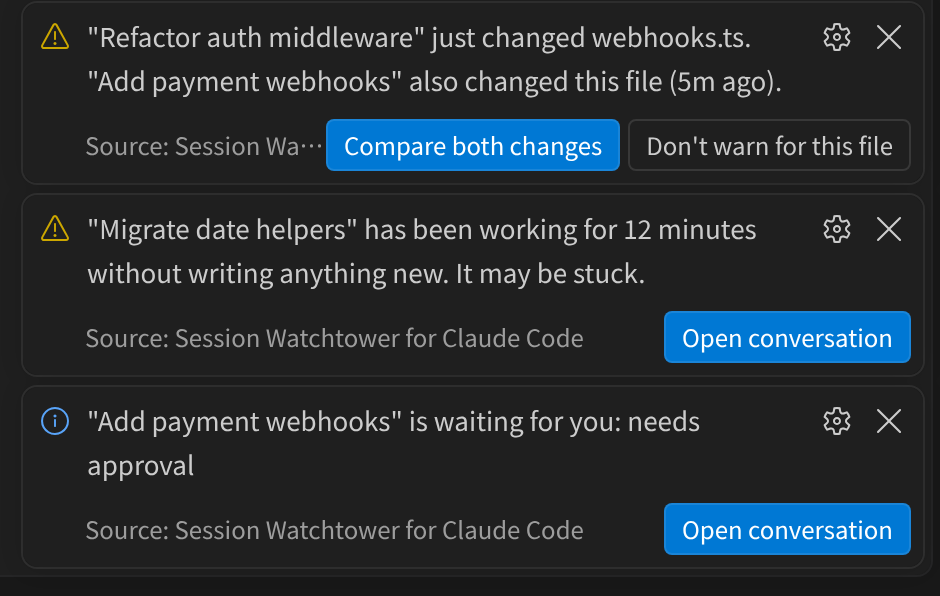

| When | What you get | Setting |
|---|---|---|
| A session in this folder starts **waiting** for your approval or answer | A notification with *Open conversation* | `notifyWaiting` |
| A session changes a file that **another session also changed** | A warning with *Compare both changes* and *Don't warn for this file* | `notifyOverlap`, `overlapIgnore` |
| A working session writes **nothing new for 10 minutes** | A warning that it may be stuck | `notifyStuckMinutes` |

About the overlap warning:

- It only uses changes that are certain (edit tools, recorded shell changes, Codex patches), not guesses.
- It stays quiet when the other session is closed and its change is already committed: that is ordinary work in sequence, not a clash.
- Files that several sessions share on purpose can be silenced one by one from the notification, or with glob patterns in `overlapIgnore`. Claude Code's memory folder is ignored by default.
- It warns after the fact, a few seconds after the change. It cannot stop an edit.

Each notification is shown once per event and only for sessions of the folder open in this window, so several windows do not repeat each other. They also work while the Session Watchtower side bar is hidden: as long as a session is working in this folder, its log is read every few seconds in the background.

## Open a session from another program

A desktop notification or a script can bring a session's conversation forward with a link:

```
vscode://kms-labs.session-watchtower/open?title=<session name>&folder=<folder name>
```

| Part | Meaning |
|---|---|
| `key` | First 12 hex characters of the SHA-256 of the session ID. Tried first. |
| `title` | The session name as the list shows it. A name cut short with `…` or `...` matches the start of the name. |
| `folder`, `root` | Optional folder names. They pick between sessions with the same name. |

- VS Code hands the link to the window that was in front last, so bring the session's window to the front first.
- When several sessions still match, you choose one from a list.
- Only sessions already in the list are opened. Nothing in the link is run or typed into the conversation.

## Find a session by what you wrote

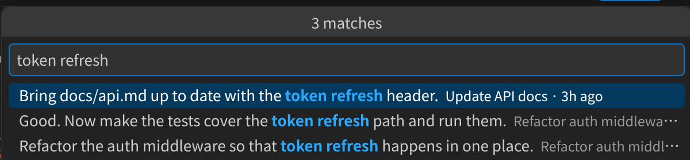

*Search conversations* (the `…` menu of the Sessions view, or Enter in the title filter box) searches **everything you typed in any session**, not just titles. All words must match. Pick a result to open that session.

The first search reads all conversation logs once to collect your own messages (a few seconds for a couple of gigabytes); after that only new lines are read.

## Which sessions changed this file?

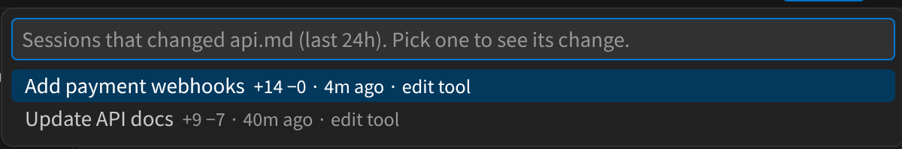

Right-click a file in the Explorer or an editor tab and choose **Session Watchtower: Which sessions changed this file?** Pick a session to see its change. It covers the selected time range.

## Copy a summary of the changes

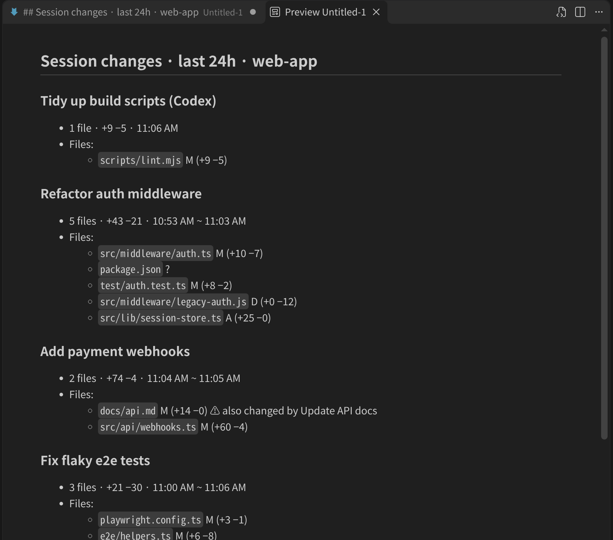

*Copy a summary* puts a Markdown list on the clipboard: per session the number of files, lines added and removed, the time span, commits and files. Use it for one session (right-click a session in the Changed files view) or for all sessions of this folder (the `…` menu of that view). It is built from the logs only; no AI is called.

## Archive, rename and older work

- **Archived section.** Sessions that have been quiet for longer than Claude Code's *Archive Inactive Sessions* setting are collected in a collapsed **Archived** section. The clock button on it lets you pick your own time (1 to 30 days, or never). The archive button on a row moves a session there by hand. An archived session comes back by itself when it gets a new message, or with its restore button.
- **Rename.** The pencil button renames a session. The new name also shows in Claude Code's own list, because it is stored the same way Claude Code stores it.
- **Older work.** A session outside the time range can be loaded on demand, as described above.

## Codex

Codex sessions from `~/.codex/sessions` appear with a *Codex* tag:

- Files edited with `apply_patch`, in the older tool-call form and in the current script form.
- Files its shell commands changed (as guesses) and its commits.
- Review and sub-agent threads are folded into the session that started them.
- Clicking a Codex session continues it in a terminal with the Codex CLI (`codex resume <id>`), started in that session's folder.

## MCP servers

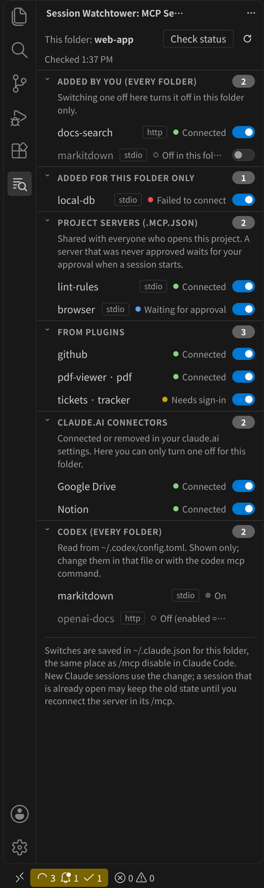

The **MCP Servers** view (collapsed at the bottom of the side bar) lists the MCP servers for the folder open in this window:

| Section | Where it comes from | Switch |
|---|---|---|
| Added by you (every folder) | `mcpServers` in `~/.claude.json` | Turns it off **in this folder only** |
| Added for this folder only | This folder's entry in `~/.claude.json` | Same |
| Project servers (`.mcp.json`) | The project's `.mcp.json`, with its approval state | Same; a rejected server stays locked until you approve it in Claude Code |
| From plugins | Shown after *Check status* | Same |
| claude.ai connectors | Shown after *Check status* (before that, the ones this machine ever connected) | Same; adding and removing them is done in your claude.ai settings |
| Codex (every folder) | `[mcp_servers.*]` in `~/.codex/config.toml` | None: shown only |

- **The switch does what `/mcp disable` and `/mcp enable` do in Claude Code**: it adds or removes the server's name in this folder's `disabledMcpServers` list in `~/.claude.json` (Claude Code keys that list by the repository root). It takes the same lock file Claude Code takes (`~/.claude.json.lock`), re-reads the file, changes only that list and writes the file in one step, so a running session's own writes are not lost. A moment later it reads the file again and warns if something rewrote it.
- **Undo** is on the notification and at the top of the view.
- **New sessions** use the change. A session that is already open may keep the old state until you reconnect the server in that session's `/mcp`.
- **Check status** runs `claude mcp list` in this folder (the Claude Code program from the Claude Code extension, or `claude` on your PATH). It connects to every server once, as a new session does, and briefly starts the local (stdio) ones, so it only runs when you press it. In a test with 47 servers it took about 12 seconds; it stops after 90 seconds.
- **Secrets stay hidden.** Only server names, types (stdio, http, sse) and states are shown. Commands, URLs, headers and environment variables are never displayed; in an error message, a URL is cut down to its host.
- The switches work once Claude Code has been started in this folder (the extension never creates the folder's entry itself).

## Plan usage

The right side of the status bar shows how much of your plan limits you have used, for example `Claude 83% · Fable 21% · Codex 23%`: Claude's overall limit, then a model's own weekly limit when your plan has one (such as Fable, which may use only part of the weekly limit), then Codex. Hover it for each limit, when it resets, how much of the weekly limit a model may use, which products the week's usage came from, and how old the value is. It turns yellow at 90% or when Claude Code itself marks a limit as a warning, and red at 100%.

| | Where the number comes from | How fresh |
|---|---|---|
| Claude | The usage Claude Code saves in `~/.claude.json` when it checks your limits (overall and per model, 5 hours and 7 days when your plan has them) | Only as fresh as Claude Code's last check. Claude Code does not re-check on every message (in one test the value stayed the same for 47 minutes while sessions worked); the tooltip says when an hour has passed, and running `/usage` in Claude Code makes it check |
| Codex | The limits recorded in your most recent Codex session log | Updated after every Codex turn; the last value is kept until its limit resets |

A limit whose reset time has passed is hidden, because its number is out of date. Turn the item off with `usageStatusBar`.

**Light on CPU.** Some usage extensions re-read every log or ask a server again and again. This one makes no network requests and reads no logs for it: on each check (every `pollSeconds`) it only looks at the size and time of two files, and reads them only when they changed. Measured on a real machine: 0.004 ms per check when nothing changed; about 1 ms to read Claude Code's settings file and about 1 ms for the end of a Codex log when they did.

## Themes

Dark and light themes are both supported; colors come from the active VS Code theme.

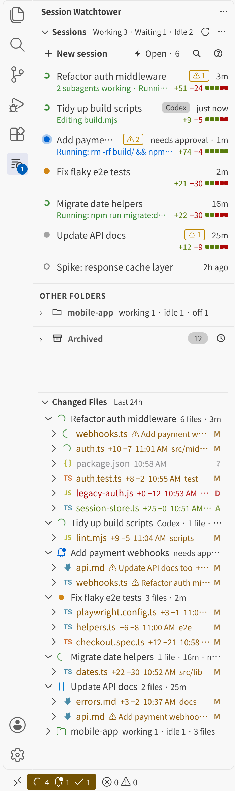

## Where the data comes from

| Source | Accuracy |
|---|---|
| Results of Claude's Edit / Write tools | Exact |
| Claude Code's own records of files changed by shell commands | Exact |
| Git commits made while the session's commit command ran | Exact |
| Codex `apply_patch` calls | Exact (98% of edits found when checked against Codex's own per-file records) |
| Shell command text (`>`, `>>`, `tee`, `sed -i`, `cp`, `mv`, `touch`) and file modification time | Best effort |
| Uncommitted files in the repository that changed while one of the session's commands ran | Best effort |

Session state is read from the files Claude Code writes in `~/.claude/sessions/`. If you use a hook that writes `<first 12 hex of sha256(session id)>.pending` files when an approval prompt appears, point `attentionMarkerDir` at that folder for an extra "waiting for you" signal.

## Privacy and what is written

- **It reads** `~/.claude/projects`, `~/.claude/sessions` and `~/.codex/sessions`, and runs `git` in your repositories (`git log`, `git status`, `git show`). The plan usage item reads Claude Code's saved usage in `~/.claude.json` and the end of the latest Codex log. The MCP Servers view also reads `~/.claude.json`, the project's `.mcp.json` and `.claude/settings*.json`, and `~/.codex/config.toml`, keeping only server names, types and on/off settings.
- **It keeps** its own files in VS Code's private storage for this extension: a read cache, the list of archived sessions, the files you silenced for overlap warnings, and an index of the messages you typed (for the conversation search).
- **Groups** (names, members, roles and the linked memo file) are kept in the same private storage. A memo file you create from a board goes either there or, only if you choose it, to the place you pick in your project; a memo file you link is only read.
- **It writes outside that storage only when you ask it to**: renaming a session appends one title line to that session's log, and an MCP switch changes this folder's `disabledMcpServers` list in `~/.claude.json`, both exactly as Claude Code does it. Your project files are never changed.
- **Network.** The extension makes no network requests and collects no telemetry. *Check status* in the MCP Servers view runs Claude Code's `claude mcp list`, and that program connects to your MCP servers.

## Requirements and limitations

- Claude Code must run on the same machine as the extension. Over Remote-SSH the extension runs on the remote host automatically.
- It relies on Claude Code's internal, undocumented file formats. A Claude Code update may break parts of it. Opening a conversation uses an internal Claude Code command (tested with Claude Code 2.1.322).
- **Guesses (`?`).** Files changed by scripts are found by their modification time: only inside a git repository, only while they are uncommitted and not git-ignored, and only the last change of each file. Another session, or you, may have saved the file while the command ran, so they stay marked as guesses.
- **"Being edited right now."** Edit tools finish in well under a second, so the spinner is shown for 30 seconds after a change while the session keeps working.
- **"May be stuck."** A command that runs for a long time without output looks the same as a stuck session.
- **Explorer marks.** They appear a few seconds after the edit starts (the logs are checked every `pollSeconds`) and stay for 30 seconds after the last change. Only files inside the folder open in this window are marked. A Codex session is noticed within a minute when no Claude Code session is working in this folder and the side bar is hidden.
- **Groups.** Roles and members are matched by session ID: a new conversation (after `/clear` or *New session*) is a new session and has to be added again. A session from another folder is listed on the board but its conversation opens only from a window with that folder. "Changes no session log explains" only looks at files changed within the time range, and it can miss a deleted file.
- **Shown in a tab.** Claude Code's tabs carry only the session name (cut to 24 characters and `…` when longer), so tabs are matched to sessions by name. When several sessions in this folder have the name, the running ones are marked, otherwise the most recent one. A conversation open in the Claude Code side bar instead of a tab is not marked.
- **Archive.** Sessions you archived or restored by hand inside Claude Code cannot be detected (Claude Code keeps that list private), and neither can its "unread" mark. If you archive by hand in Claude Code, set the archive time to something short such as 1 day so finished sessions leave the list here too. Sessions started by scripts through the SDK are left out of the list, as in Claude Code.
- **Search.** Only your own messages are indexed, up to 2,000 characters each, from Claude Code and Codex sessions (Codex review and sub-agent threads are left out).
- **Which sessions changed this file** and the summaries only cover the selected time range.
- **Codex.** There is no list of running Codex sessions, so a Codex session counts as working only while its log changed in the last 90 seconds, and Codex sessions are shown only while their log changed inside the time range. A patch that the script builds at run time, or a script that failed after its patch was applied, is missed. Opening needs the `codex` command, and the Codex extension itself has no command to open a conversation by ID.
- **MCP servers.** The switches follow Claude Code's own `/mcp disable` storage as of Claude Code 2.1.323; a later Claude Code may store it differently. Plugin servers and claude.ai connectors appear only after a status check, because Claude Code fetches them when it starts. If `CLAUDE_CONFIG_DIR` is set for the extension, its `.claude.json` is used. Not tested on Windows.
- If the Sessions view says *There is no data provider registered* right after updating from 0.6.0, run **Developer: Reload Window** once.
- The interface is in English and switches to Korean automatically when VS Code's display language is Korean.

## Settings

All settings start with `claudeSessionChanges.`

| Setting | Default | Meaning |
|---|---|---|
| `lookbackHours` | 24 | How many hours of changes the Changed files view shows. Decimals work (0.5 = 30 minutes); the clock button also offers 10 to 50 minutes. |
| `showShellGuesses` | true | Show files that are only guesses (`?`). |
| `hideScratchpadFiles` | true | Hide Claude's throwaway scratchpad files (git worktrees inside it stay visible). |
| `includeSubagents` | true | Include files changed by subagents under their parent session. |
| `pollSeconds` | 5 | How often to check for new log lines. |
| `statusBar` | true | Show the status bar summary. |
| `usageStatusBar` | true | Show Claude Code and Codex plan usage in the status bar. |
| `notifyWaiting` | true | Notify when a session in this folder starts waiting for you. |
| `notifyOverlap` | true | Notify when a session changes a file that another session also changed. |
| `overlapIgnore` | Claude's memory folder | Glob patterns of files that never get an overlap warning. |
| `notifyStuckMinutes` | 10 | Notify when a working session has written nothing new for this many minutes (0 = off). |
| `explorerMarks` | true | Mark the file a session is editing right now in the Explorer and on editor tabs. |
| `boardPageSize` | 20 | Rows per page in Instructions and results on group boards. |
| `sessionDetails` | true | Show the second line under each session. Turn off for a compact list. |
| `archiveAfter` | Same as Claude Code | When a quiet session moves to Archived: same as Claude Code, 1 to 30 days, or never. |
| `sessionListDays` | 90 | List this folder's sessions from the last N days even when they are not running (0 = only running sessions and sessions with changes in the time range). |
| `includeCodex` | true | Also show Codex sessions. |
| `attentionMarkerDir` | `~/.cache/claude-attention` | Folder of approval-hook marker files (empty = off). |

## Commands

Available from the Command Palette under **Session Watchtower**, and from the menus mentioned above.

| Command | What it does |
|---|---|
| Check MCP server status | Open the MCP Servers view and check every server of this folder. |
| Start a team with a lead session | Copy a request that makes a session the lead: it recommends the team, creates the team board and then takes reports and gives instructions. |
| New group / Open a group board / Rename a group / Delete a group | Work with groups (deleting a group leaves its sessions as they are). |
| Search conversations | Find a session by what you wrote in it. |
| Which sessions changed this file? | List the sessions that changed the current or selected file. |
| Copy a summary of all sessions' changes in this folder | Markdown summary on the clipboard. |
| Choose when sessions move to Archived | Pick the archive time. |
| Warn about overlapping edits for every file again | Forget the files you silenced. |
| Change time range | How far back the Changed files view looks. |
| Show open sessions only / Show all sessions | Filter the Changed files view. |
| Refresh | Read the logs again now. |

## Development

No build step and no dependencies. Run the tests with `npm test` (Node 20 or newer). They use a fake home folder with made-up session logs and a stub of the VS Code API, so they never read your real `~/.claude`.

`npm run shot` (Linux) takes the real screenshots used in this page: it starts desktop VS Code on a virtual display (Xvfb) with the extension and made-up demo sessions, and writes pictures to `.shots/`. Scenes: `side`, `toasts`, `search`, `file`, `review`, `summary`, `explorer`, `tabs`, `groups`, `roles`, `mcp` and `gif`, for example `npm run shot -- side light`. It needs desktop VS Code, `xvfb-run`, ImageMagick and Python 3 with Pillow.

## Feedback and contact

Questions, bug reports and ideas are welcome: **k4858678@gmail.com**, or open an issue on GitHub.

## 한국어 요약

Claude Code 세션을 여러 개 돌릴 때 **어느 세션이 일하는 중이고, 어느 세션이 멈춰서 나를 기다리고, 어느 세션이 어떤 파일을 바꿨는지**를 옆 창 하나에서 봅니다.

- **세션 상태 창**: 지금 탭에 띄워 둔 대화(탭 묶음마다 앞에 보이는 탭)는 바탕색과 왼쪽 막대로 따로 보입니다. 이 폴더의 세션마다 상태(작업 중·기다림·방금 끝남·쉼·꺼짐), 지금 하는 일, 변경 규모가 나옵니다. 실행 중이 아니어도 나오고, 다른 폴더 세션은 아래에 묶여 나옵니다.
- **변경 파일 창**: 세션이 바꾼 파일과 줄 수가 나오고, 누르면 비교 화면이 열립니다. 지금 고치는 파일에는 초록 회전 표시가 붙습니다. 색은 git과 같습니다: 초록 A 새 파일, 노랑 M 수정, 빨강 D 지워짐, 회색 ? 추정.
- **파일 탐색기에도**: 세션이 지금 고치는 파일은 VS Code 파일 탐색기와 편집기 탭에서 도는 배지와 초록 이름으로 보입니다. 그 파일이 든 폴더에는 초록 점이 붙습니다.
- **알림**: 세션이 승인이나 답을 기다릴 때, 두 세션이 같은 파일을 고쳤을 때, 작업 중인 세션이 10분 넘게 조용할 때 알려 줍니다.
- **찾기**: 내가 세션에 쓴 말로 세션을 찾고, 파일을 우클릭해 그 파일을 고친 세션을 봅니다.
- **그룹과 보드**: 함께 일하는 세션(감시·개발·배포 등)을 그룹으로 묶고 역할을 붙입니다. 처음 시작할 때는 "대장 세션으로 팀 꾸리기" 요청 글을 새 세션에 붙여 넣으면 그 세션이 대장이 되어 팀 구성 추천, 협업 보드 만들기, 세션별 첫 지시, 보고받고 지시하기를 맡습니다. 역할 꼬리표는 이름표라서, 보드의 "역할 안내"를 그 세션에 붙여 넣어야 세션이 자기 역할과 함께 일하는 규칙을 압니다(처음 쓰는 프로젝트도 그대로 쓸 수 있음). 그룹 보드 한 화면에서 기다리는 세션, 세션별 현황(커밋 안 한 파일 포함), 세션 기록으로 설명되지 않는 변경, 내가 한 말(시각과 함께 복사), 공유 메모 파일을 봅니다.
- **정리**: 보관함, 세션 이름 바꾸기, 변경 요약을 마크다운으로 복사.
- **바깥에서 열기**: 데스크톱 알림 같은 다른 프로그램이 `vscode://kms-labs.session-watchtower/open?title=…` 주소로 그 세션의 대화를 열 수 있습니다.
- **Codex** 세션도 함께 나옵니다.
- **요금제 사용량**: 상태 표시줄 오른쪽에 Claude Code·Codex 한도를 몇 % 썼는지(예: `Claude 83% · Fable 21% · Codex 23%`) 보여 줍니다. Fable처럼 모델마다 따로 있는 주간 한도도 따로 나옵니다. 마우스를 올리면 칸별 값, 초기화 시각, 모델이 주간 한도의 몇 %까지 쓸 수 있는지, 이번 주 사용 비율, 몇 분 전 값인지가 나옵니다. Claude는 Claude Code가 `~/.claude.json`에 받아 둔 값이라 Claude Code가 다시 확인할 때만 바뀝니다(`/usage`를 열면 확인). Codex는 마지막 Codex 기록의 값입니다. 인터넷에 묻지 않고, 두 파일의 크기·시각만 보다가 바뀌었을 때만 읽어서 CPU를 거의 쓰지 않습니다.
- **보드 목차 접기**: 그룹 보드의 나를 기다리는 것·세션·지시와 결과·공유 메모 제목을 누르면 접히고, 그룹마다 기억합니다.
- **MCP 서버 창**: 이 폴더에서 Claude Code가 쓰는 MCP 서버(직접 추가·이 폴더·프로젝트 `.mcp.json`·플러그인·claude.ai 커넥터)와 Codex 서버를 봅니다. "상태 확인"은 누를 때만 `claude mcp list`를 실행합니다(서버마다 한 번 붙어 보고 로컬 서버는 잠깐 실행). 스위치는 Claude Code의 `/mcp disable`과 같은 곳(`~/.claude.json`의 이 폴더 `disabledMcpServers`)에 써서 **이 폴더에서만** 끄고 켭니다. 새로 여는 세션부터 적용되고, 알림과 창 맨 위에 "되돌리기"가 있습니다. 명령·주소·환경 변수 값은 화면에 나오지 않습니다. Codex 서버는 보기만 합니다.

프로젝트 파일은 건드리지 않고, 기록은 이 컴퓨터 밖으로 나가지 않습니다(MCP "상태 확인"을 누르면 Claude Code 프로그램이 서버에 접속하는 것은 예외). 세션 이름을 바꿀 때 그 세션의 대화 기록 끝에 제목 한 줄을 덧붙이고, MCP 스위치를 누를 때 `~/.claude.json`의 이 폴더 항목 한 칸을 바꿉니다(둘 다 Claude Code가 하는 방식과 같습니다).

문의·버그 제보·아이디어: **k4858678@gmail.com**
